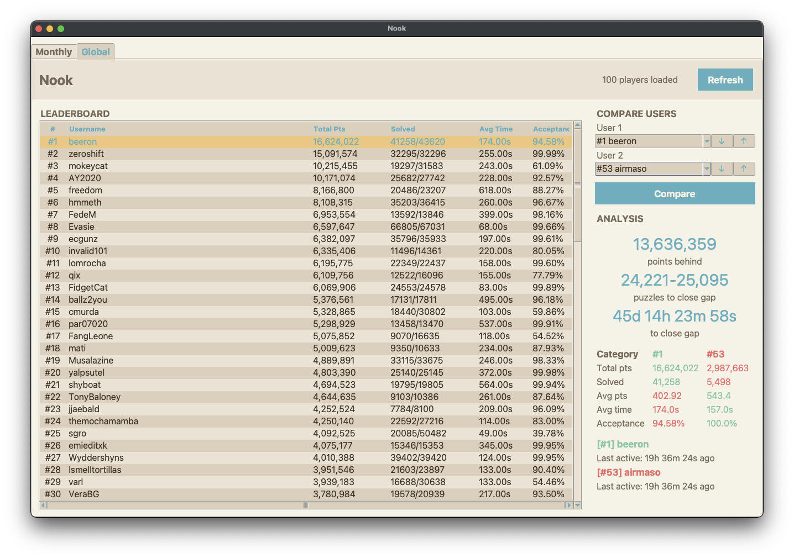

# Nook

## Usage
To run the desktop application:
```sh
python3 -m venv .venv
source .venv/bin/activate
pip3 install -r apps/desktop/requirements.txt
python3 -m apps.desktop.main
```

<p align="center">
  
</p>

To run a live scrape of both leaderboards:
```sh
go run cmd/nookscrape/main.go

---- MonthlyLeaderboard (100 users, 633ms)
  1 @airmaso                          753784 pts  
  2 @gravybara                        686092 pts  
  3 @hcaelxx                          648831 pts  
  ...
...
```
